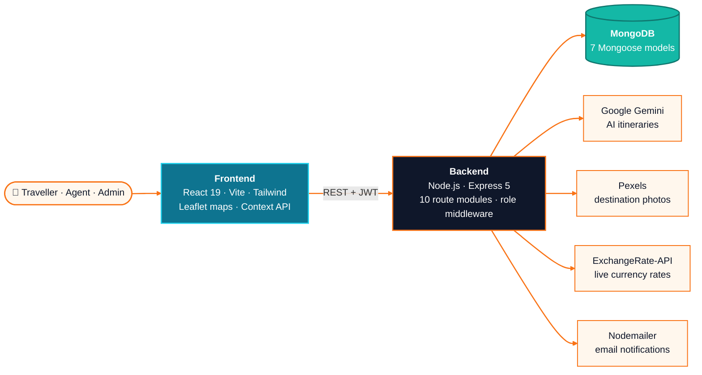
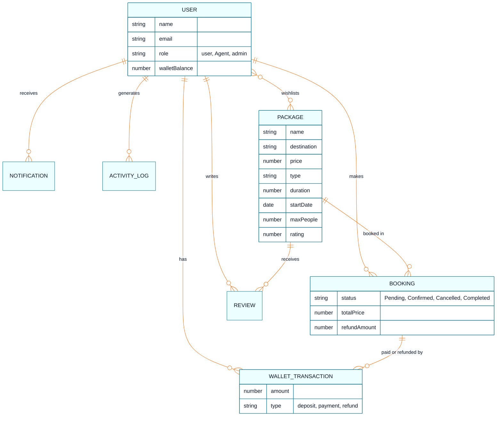
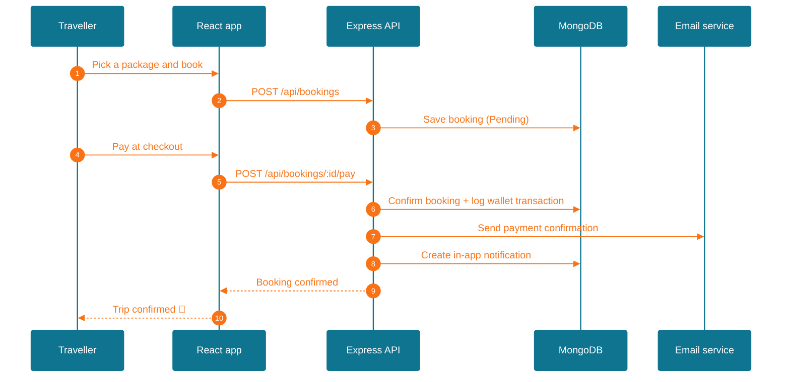

<div align="center">


<a href="https://github.com/sabikswanan/Travel-and-Tourism-Website"></a>

<br/>

<a href="https://travel-and-tourism-website-chi.vercel.app"></a>


<br/><br/>

**[Overview](#overview)** &nbsp;|&nbsp;
**[Features](#features)** &nbsp;|&nbsp;
**[Architecture](#architecture)** &nbsp;|&nbsp;
**[Booking Flow](#booking-flow)** &nbsp;|&nbsp;
**[API](#api)** &nbsp;|&nbsp;
**[Getting Started](#getting-started)** &nbsp;|&nbsp;
**[Author](#author)**

</div>

<br/>

<a name="overview"></a>

## 🌍 Overview

A full-stack **travel booking platform** built on the **MERN stack**. Travellers can discover tour
packages, see every stop on an interactive map, plan trips with an **AI itinerary generator**, pay,
and manage bookings, refunds and a wallet. Travel agents and admins get their own dashboards for
packages, inventory, bookings, sales reports, user roles and activity logs.

> [!NOTE]
> **Built as a team project for CSE471 — System Analysis and Design at BRAC University**, covering the
> full cycle from requirements to a deployed React frontend and a REST API backed by MongoDB.

<br/>

<a name="features"></a>

## ✨ Features

<table>
<tr>
<td valign="top" width="50%">

#### 🧳 For travellers
- Browse and filter packages by **type and destination**
- Package pages with **day-by-day itinerary** and an **interactive Leaflet map**
- **Wishlist**, **reviews and ratings**
- Prices in **8 currencies** using live exchange rates
- Secure checkout with a **simulated payment gateway**
- **My Bookings** with cancellation and automatic refunds
- **Wallet** with full transaction history
- **Notification center** with booking and payment updates

</td>
<td valign="top" width="50%">

#### 🛠️ For agents and admins
- Create, edit and deactivate **tour packages**
- **AI itinerary generator** (Google Gemini) with matching destination photos
- **Inventory** view of booked seats, capacity and occupancy rate
- Manage **all bookings** and their status
- **Sales reports** dashboard
- **User and role management**
- Full **activity log** of who did what and when

</td>
</tr>
</table>

<details>
<summary><b>Package types</b></summary>
<br/>


</details>

<details>
<summary><b>Supported currencies</b></summary>
<br/>


</details>

<br/>

<a name="architecture"></a>

## 🏗️ Architecture



<details>
<summary><b>Data model</b></summary>
<br/>



</details>

<br/>

<a name="booking-flow"></a>

## 🧭 Booking Flow



### Cancellation and refunds

Refunds are calculated automatically from how early the trip is cancelled and credited straight to
the traveller's **wallet**, with an email and an in-app notification.

| Cancelled before the trip starts | Refund |
|---|:---:|
| 30 days or more | **90%** |
| 7 – 29 days | **50%** |
| Less than 7 days | **0%** |

<br/>

<a name="api"></a>

## 🔌 API

**36 REST endpoints** across 10 route modules, protected by **JWT authentication** and
**role-based middleware**.

<details>
<summary><b>View all endpoints</b></summary>
<br/>

| Module | Endpoints |
|---|---|
| **Auth** `/api/auth` | `POST /register` · `POST /login` · `GET /profile` · `PUT /profile` |
| **Packages** `/api/packages` | `GET /` · `GET /:id` · `GET /types` · `GET /destinations` · `GET /inventory` · `GET /image-search` · `POST /generate-itinerary` · `POST /` · `PUT /:id` · `PATCH /deactivate/:id` · `DELETE /:id` |
| **Bookings** `/api/bookings` | `POST /` · `GET /` · `GET /my` · `PUT /:id` · `POST /:id/pay` · `PATCH /:id/cancel` · `GET /reports` |
| **Payments** `/api/payments` | `POST /initiate` · `POST /callback` |
| **Wallet** `/api/wallet` | `GET /` |
| **Wishlist** `/api/wishlist` | `GET /` · `POST /add` · `POST /remove` |
| **Reviews** `/api/reviews` | `GET /:packageId` · `POST /:packageId` |
| **Notifications** `/api/notifications` | `GET /` · `PATCH /:id/read` |
| **Currency** `/api/currency` | `GET /rates` |
| **Admin** `/api/admin` | `GET /users` · `PUT /users/:id/role` · `GET /logs` |

</details>

<br/>

<a name="getting-started"></a>

## 🚀 Getting Started

**1. Clone**

```bash
git clone https://github.com/sabikswanan/Travel-and-Tourism-Website.git
cd Travel-and-Tourism-Website
```

**2. Backend**

```bash
cd backend
npm install
npm run dev        # http://localhost:5000
```

**3. Frontend**

```bash
cd frontend
npm install
npm run dev        # http://localhost:5173
```

<details>
<summary><b>Environment variables</b></summary>
<br/>

Create `backend/.env`:

| Variable | Purpose |
|---|---|
| `MONGO_URI` | MongoDB connection string |
| `JWT_SECRET` | Secret for signing login tokens |
| `PORT` | API port (default `5000`) |
| `FRONTEND_URL` | Allowed frontend origin for CORS |
| `GEMINI_API_KEY` | AI itinerary generation (falls back to a template if missing) |
| `PEXELS_API_KEY` | Destination photos for itineraries |
| `EXCHANGE_RATE_API_KEY` | Live currency rates |
| `MASTER_ADMIN_EMAIL` | Email of the master admin account |

Create `frontend/.env`:

| Variable | Purpose |
|---|---|
| `VITE_API_URL` | Backend API URL (default `http://localhost:5000/api`) |

</details>

<br/>

## 🗺️ Roadmap

- [ ] Connect a live payment gateway in place of the simulator
- [ ] Switch development email to a production mail provider
- [ ] Trip reminder emails before the start date
- [ ] Automated tests for the API and key user flows

<br/>

<a name="author"></a>

## 👤 Author

<div align="center">

### Sabik Swanan

B.Sc. in Computer Science · BRAC University

<br/>

<a href="https://github.com/sabikswanan"></a>
<a href="https://www.linkedin.com/in/sabikswanan"></a>
<a href="https://mail.google.com/mail/?view=cm&fs=1&to=sabikswanan@gmail.com"></a>

<br/><br/>

<sub>⭐ Star this repo if you found it useful</sub>


</div>
